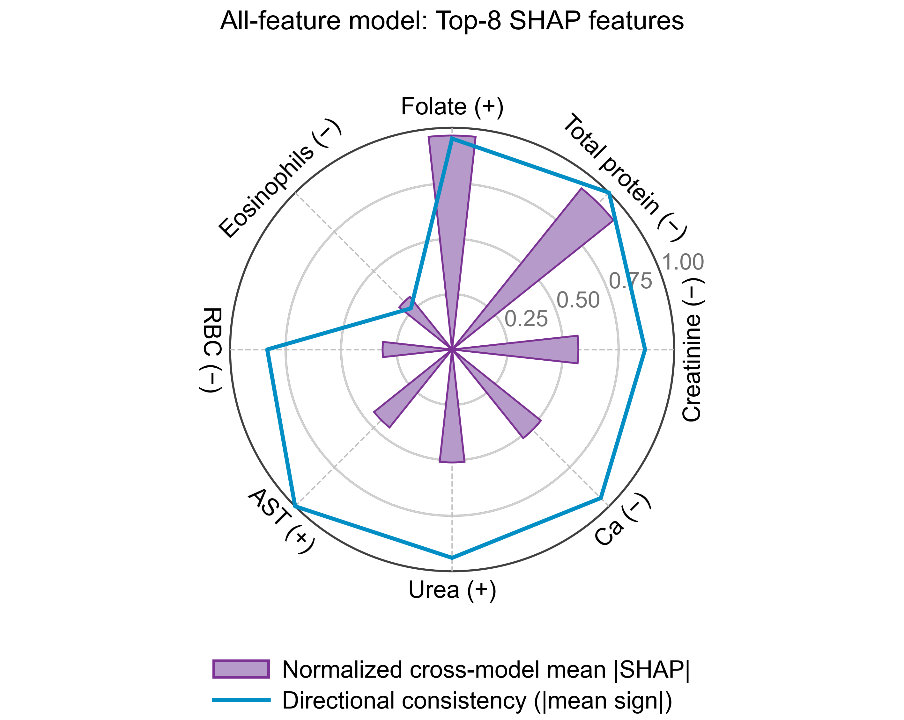

# Binge Eating and Sleeve Gastrectomy — Analysis Workflows

[](https://www.python.org/)
[](https://www.r-project.org/)
[](https://docs.astral.sh/uv/)
[](https://rstudio.github.io/renv/)

**Associated manuscript:** *Beyond Weight Loss After Sleeve Gastrectomy: An Exploratory Cohort Study of Preoperative Binge Eating Status and Early Postoperative Outcomes*

## Overview

Previous research on preoperative binge eating (BE) in bariatric surgery has focused largely on weight-loss outcomes, while early postoperative biochemical profiles remain less well characterized. This repository provides Python and R analysis workflows accompanying an exploratory retrospective cohort study examining preoperative BE screening status and early outcomes after laparoscopic sleeve gastrectomy (LSG). The workflows cover follow-up missingness, preoperative group comparisons, exploratory machine learning and SHapley Additive exPlanations (SHAP) interpretation, postoperative longitudinal models and missing-data sensitivity analyses, and adiposity–immune associations.

The demonstration uses synthetic data representing 122 participants (66 non-BE and 56 BE), structured around baseline and postoperative assessments at months 1, 3, and 6.


> **Data scope:** The executable datasets and analysis outputs generated by this repository are synthetic and do not reproduce the original study's numerical findings. The underlying patient-level clinical data are not publicly available due to patient privacy and institutional data-sharing restrictions. Materials derived from the original clinical analysis are explicitly identified. **No patient-level clinical data are shared.** For information on requesting access to the original clinical data, see [Original clinical data availability](#original-clinical-data-availability).

## Contents

- [Study design and analytical framework](#study-design-and-analytical-framework)
- [Repository structure](#repository-structure)
- [Synthetic data](#synthetic-data)
- [Analysis outputs](#analysis-outputs)
- [Method highlight: SHAP importance and directional consistency](#method-highlight-shap-importance-and-directional-consistency)
- [Installation](#installation)
- [Run the analysis workflows](#run-the-analysis-workflows)
- [Limitations and intended use](#limitations-and-intended-use)

*Click any section above to jump directly to it.*

## Study design and analytical framework

The associated clinical study was a single-center retrospective longitudinal cohort of 122 adults undergoing primary LSG, comprising 66 non-BE and 56 BE participants. Preoperative BE status was defined using a Binge Eating Scale (BES) score >17, representing a screening classification rather than a clinical diagnosis of binge-eating disorder. Assessments were scheduled at baseline (M0) and 1, 3, and 6 months after surgery (M1, M3, and M6), with incomplete laboratory follow-up.

The analytical framework addressed three complementary research questions:

- **BE-group comparisons and preoperative feature prioritization:** Differences in baseline clinical and laboratory characteristics, perioperative variables, and 6-month weight-loss outcomes were examined by preoperative BE status. Conventional comparisons of preoperative laboratory measures were complemented by exploratory machine learning for feature prioritization and SHAP-based interpretation.

- **Postoperative trajectories:** Mixed models for repeated measures (MMRM) examined changes in anthropometric and laboratory outcomes during the first 6 months after LSG, differences in trajectories by preoperative BE status, and the sensitivity of between-group findings to missing at random (MAR) and missing not at random (MNAR) assumptions.

- **Adiposity–immune associations:** Exploratory analyses examined associations of baseline body weight and body mass index (BMI), and their postoperative changes, with circulating immune cell counts in the pooled BE and non-BE cohort.

The repository implements this analytical framework using synthetic data, organized into six modules:

```text
Synthetic cohort (BE / non-BE; M0, M1, M3, M6)
│
├── Module 01   Follow-up availability and missingness
│
├── BE-group comparisons and feature prioritization
│   ├── Module 02   Baseline, perioperative, and 6-month comparisons
│   └── Module 03   Preoperative machine learning and SHAP
│
├── Module 04   Postoperative MMRM and MAR/MNAR sensitivity
│
└── Module 05   Pooled adiposity–immune associations

Outputs from Modules 01–05 → Module 06 (final composite figures)
```

Detailed analytical methods are provided in [METHODS.md](METHODS.md).

## Repository structure

```text
binge-eating-bariatric-analysis/
├── code/                                  # Python and R analysis modules (01–06)
│   ├── 01_followup_missingness/
│   ├── 02_preoperative_group_comparison/
│   ├── 03_preoperative_machine_learning/
│   ├── 04_postoperative_longitudinal_analysis/
│   ├── 05_immune_cell_analysis/
│   └── 06_figure_assembly/
├── data/                                  # Three synthetic CSV datasets
│   ├── bariatric_longitudinal.csv
│   ├── followup_attendance.csv
│   └── preoperative_group_comparison.csv
├── outputs/                               # Synthetic analysis tables, models, and figures
│   ├── 01_followup_missingness/
│   ├── 02_preoperative_group_comparison/
│   ├── 03_preoperative_machine_learning/
│   ├── 04_postoperative_longitudinal_analysis/
│   ├── 05_immune_cell_analysis/
│   └── 06_final_figures/
├── renv/                                  # R environment activation and configuration
│   ├── .gitignore
│   ├── activate.R
│   └── settings.json
├── .Rprofile                              # Activates renv on R startup
├── .gitattributes                         # Excludes generated EPS figures from language statistics
├── .gitignore                             # Excludes local environments and caches
├── .python-version                        # Python version (3.11.7)
├── .renvignore                            # Excludes non-code directories from R dependency scanning
├── METHODS.md                             # Detailed methods (SM1–SM6) and references
├── README.md                              # Project overview and usage instructions
├── binge-eating-bariatric-analysis.Rproj  # Optional RStudio project configuration
├── pyproject.toml                         # Python project configuration and dependencies
├── renv.lock                              # Locked R package dependencies
├── run_standard.sh                        # Run standard analyses
├── shap_cross_model_radar.png             # Aggregate SHAP radar from original clinical analysis
└── uv.lock                                # Locked Python package dependencies
```

| Module | Analysis | Language |
| --- | --- | --- |
| [01](code/01_followup_missingness/) | Follow-up attendance, indicator availability, and missingness diagnostics | Python |
| [02](code/02_preoperative_group_comparison/) | Baseline, perioperative, and 6-month comparisons; distribution diagnostics, biomarker thresholds, sex adjustment, and raincloud plots | Python |
| [03](code/03_preoperative_machine_learning/) | Feature ranking, repeated cross-validated model evaluation, permutation importance, and SHAP interpretation | Python |
| [04](code/04_postoperative_longitudinal_analysis/) | Postoperative longitudinal MMRM, adjusted trajectories, and MAR/MNAR sensitivity analyses | R |
| [05](code/05_immune_cell_analysis/) | Baseline, cumulative, and adjacent-interval adiposity–immune associations, descriptive plots, and model diagnostics | R |
| [06](code/06_figure_assembly/) | Final composite figure assembly (PNG, SVG, and EPS) | Python / R |

## Synthetic data

The [`data/`](data/) directory contains three CSV datasets representing the same synthetic cohort, organized for different analyses:

| File | Dimensions (rows × columns) | Description |
| --- | --- | --- |
| [`followup_attendance.csv`](data/followup_attendance.csv) | 122 × 12 | Visit attendance and follow-up availability |
| [`preoperative_group_comparison.csv`](data/preoperative_group_comparison.csv) | 122 × 45 | Baseline clinical and laboratory characteristics, perioperative variables, and 6-month weight-loss outcomes |
| [`bariatric_longitudinal.csv`](data/bariatric_longitudinal.csv) | 488 × 40 | Baseline and postoperative anthropometric and laboratory measurements (M0, M1, M3, M6) |

### Original clinical data availability

The clinical data supporting the findings of this study are not publicly available due to patient privacy and institutional data-sharing restrictions. Requests for access to these data may be directed to the corresponding author and are subject to approval by the Third People's Hospital of Chengdu.

## Analysis outputs

The repository contains **15 Excel tables** (Tables 1–3 and S1–S12), **11 final composite figures** (each available in PNG, SVG, and EPS formats), and **200 saved machine-learning models**. Modules 01–05 generate individual figure panels and supporting outputs, which are assembled into final composite figures by Module 06.

The standard workflow regenerates **13 Excel tables** (Tables 1–3, S1–S8, and S11–S12). **Tables S9 and S10** are also included in the repository but require the optional full MNAR sensitivity analysis for regeneration because of its computational cost.

### Final composite figures

| Figure | Content |
| --- | --- |
| [Figure 1](outputs/06_final_figures/png_600dpi/Fig1_preoperative_biomarkers_ml.png) | Preoperative nutritional biomarkers, feature ranking, and SHAP importance and directional consistency |
| [Figure 2](outputs/06_final_figures/png_600dpi/Fig2_postoperative_trajectories.png) | Adjusted trajectories of selected nutritional and hepatic biomarkers by BE status |
| [Figure 3](outputs/06_final_figures/png_600dpi/Fig3_adiposity_immune_associations.png) | Associations of baseline adiposity and postoperative adiposity change with immune cell counts |
| [Figure S1](outputs/06_final_figures/png_600dpi/FigS1_followup_bes.png) | Laboratory follow-up availability and baseline BES score distribution |
| [Figure S2](outputs/06_final_figures/png_600dpi/FigS2_permutation_shap.png) | Held-out permutation importance and SHAP summaries for all-feature and fixed Top-4 models |
| [Figure S3 — Part 1](outputs/06_final_figures/png_600dpi/FigS3_part1_anthropometrics_nutrition.png) | Adjusted anthropometric and nutritional trajectories |
| [Figure S3 — Part 2](outputs/06_final_figures/png_600dpi/FigS3_part2_metabolic.png) | Adjusted metabolic and electrolyte trajectories |
| [Figure S3 — Part 3](outputs/06_final_figures/png_600dpi/FigS3_part3_immune.png) | Adjusted immune-cell trajectories |
| [Figure S4](outputs/06_final_figures/png_600dpi/FigS4_baseline_scatter.png) | Raw baseline scatterplots of adiposity and immune cell counts |
| [Figure S5](outputs/06_final_figures/png_600dpi/FigS5_current_value_paths.png) | Observed participant-level adiposity–immune paths (current values) |
| [Figure S6](outputs/06_final_figures/png_600dpi/FigS6_change_from_baseline_paths.png) | Observed participant-level adiposity–immune paths (changes from baseline) |

Click a figure name to view its full-resolution PNG, or [browse all final figure exports](outputs/06_final_figures/) (PNG, SVG, and EPS). Individual figure panels, analysis tables, saved models, and supporting files are organized by module under [`outputs/`](outputs/).

## Method highlight: SHAP importance and directional consistency

### Why examine attribution consistency?

SHAP attributes the predictions of a fitted model to individual features, describing both the magnitude and sign of their contributions. However, models with similar predictive performance may assign different contributions to the same feature. An interpretation based on a single selected model may therefore overlook variation in attribution patterns across training splits or algorithms.

In this study, we examined two complementary aspects of SHAP attribution: feature importance and directional consistency. We summarized relative feature importance by aggregating normalized mean absolute SHAP values across algorithms, and used a simple rank-based sign metric to summarize the directional consistency of feature–SHAP relationships across cross-validation folds and learning algorithms.

### Methodological approach
SHAP attributions were examined for LightGBM and CatBoost using stratified fivefold outer cross-validation repeated 10 times, yielding 50 outer train–test splits shared across algorithms and feature panels. Within each split, hyperparameters were selected using threefold inner cross-validation, and models were refitted on the corresponding outer-training data. SHAP values were then calculated for held-out participant–repeat observations on the raw model-output (log-odds) scale.

**Cross-algorithm feature importance.** For feature $f$ and algorithm $a$, the mean absolute SHAP value was calculated across all held-out participant–repeat observations, including those with missing raw feature values:

```math
I_a(f)=\mathrm{mean}\left(|\mathrm{SHAP}_a(f)|\right).
```

To summarize relative importance across algorithms, mean absolute SHAP values were normalized to the maximum importance within each algorithm and feature panel, then averaged across algorithms:

```math
I_{\mathrm{norm}}(f)
=
\frac{1}{A}
\sum_{a=1}^{A}
\frac{I_a(f)}
{\max_{g\in\mathcal{F}} I_a(g)}.
```

Here, $A=2$ denotes the number of algorithms, and $\mathcal{F}$ denotes all features in the corresponding panel. This normalization places algorithm-specific importance profiles on a common relative scale before aggregation.

**Directional consistency.** For feature $f$, algorithm $a$, and outer fold $j$, the direction of the feature–SHAP relationship was assessed using the Spearman correlation between observed feature values and their corresponding SHAP contributions:

```math
\rho_{a,j}(f)
=
\mathrm{Spearman}
\left\{X_{j,f},\mathrm{SHAP}_{a,j}(f)\right\}.
```

Correlations required at least three finite feature–SHAP pairs and variation in both quantities. For each estimable correlation, a three-level directional sign was assigned:

```math
s_{a,j}(f)=
\begin{cases}
\mathrm{sign}\left[\rho_{a,j}(f)\right],
& |\rho_{a,j}(f)|\geq 0.05,\\
0,
& |\rho_{a,j}(f)|<0.05.
\end{cases}
```

The threshold of 0.05 was used as a near-zero tolerance, not as a statistical-significance threshold. Let $V_{a,f}$ denote the set of outer folds with estimable directions for feature $f$ under algorithm $a$, and let $n_{a,f}=|V_{a,f}|$. The algorithm-specific directional score was calculated as:

```math
S_a(f)
=
\frac{1}{n_{a,f}}
\sum_{j\in V_{a,f}}s_{a,j}(f),
\qquad n_{a,f}>0.
```

The signed directional scores were then averaged across algorithms, and their absolute value was used to summarize net directional consistency:

```math
S_{\mathrm{overall}}(f)
=
\frac{1}{A}
\sum_{a=1}^{A}S_a(f),
\qquad
S_{\mathrm{abs}}(f)
=
\left|S_{\mathrm{overall}}(f)\right|.
```

If either algorithm had no estimable folds for a feature, the corresponding algorithm-specific score and cross-algorithm summaries were recorded as not estimable (NA). When estimable, $S_{\mathrm{abs}}(f)$ ranges from 0 to 1, with higher values indicating stronger net directional consistency across folds and algorithms. The sign of $S_{\mathrm{overall}}(f)$ indicates whether higher feature values tended to correspond to more positive (+) or more negative (−) SHAP contributions, while a zero score indicates no net directional tendency.

Full methodological specifications are provided in [METHODS.md](METHODS.md), particularly Supplementary Methods SM4.

### Illustrative example: SHAP attributions for calcium and creatinine

The radar below presents aggregate SHAP results from the original clinical analysis, rather than the synthetic data provided in this repository. It displays the eight highest-ranked features among 28 preoperative laboratory variables, based on mean absolute SHAP importance normalized across all 28 features within each algorithm and then averaged across algorithms.

<p align="center">
  <a href="shap_cross_model_radar.png"></a>
</p>

*Purple bars represent normalized cross-algorithm mean absolute SHAP importance, while the blue line represents absolute net directional consistency across cross-validation folds and algorithms. The (+) and (−) signs indicate the net direction of the feature–SHAP relationship.*

In the original analysis, algorithm-specific SHAP beeswarm plots showed that some features exhibited different, and occasionally opposing, directional attribution patterns across models. This motivated us to examine directional consistency across cross-validation folds and algorithms rather than relying on individual model explanations alone. After aggregation, the net directional signs of the eight features displayed in the radar were consistent with the directions of their corresponding preoperative between-group differences.

The contrasting patterns of calcium and creatinine further illustrate the value of examining directional consistency alongside feature importance. In conventional preoperative comparisons, calcium differed significantly between the BE and non-BE groups, whereas creatinine did not. The integrated feature-ranking analysis also placed calcium ahead of creatinine. However, creatinine showed greater SHAP importance than calcium in some algorithm-specific analyses, and its normalized importance remained higher after cross-algorithm aggregation. Interestingly, despite its lower aggregated SHAP importance, calcium exhibited stronger net directional consistency than creatinine across cross-validation folds and algorithms.

During interpretation of the creatinine SHAP results, we revisited the extreme preoperative creatinine findings as an additional data-verification step, comparing the recorded values with the original laboratory reports and corresponding postoperative measurements. These checks supported retaining the recorded values rather than treating them as data-entry errors. Given the modest sample size and repeated train–test splits, such extreme observations could affect model fitting and feature attributions differently across training subsets. Whether they contributed to the observed attribution differences requires further investigation.

### Interpretation and limitations

A feature with high SHAP importance does not necessarily exhibit consistent attribution directions across fitted models. By examining importance and directional consistency together, we can identify features whose attribution patterns warrant closer investigation, rather than relying on a single model or importance ranking. Such discrepancies may offer clues about the influence of individual observations, feature correlations, and model dependence. For studies with small samples or potentially correlated predictors, applying this approach across several comparably performing models may help reveal differences in feature attribution that warrant further examination.

This approach provides an exploratory assessment of net directional agreement, rather than evidence of biological importance or causal effects. Further research across different datasets, sample sizes, and model families is needed to evaluate its broader applicability.

## Installation

The workflow uses **Python 3.11.7** and **R 4.5.1**, with dependencies managed by [uv](https://docs.astral.sh/uv/) and [renv](https://rstudio.github.io/renv/). Install uv and R, and make sure the required R version is on your `PATH`. The Arial font is required for figure generation.

From the repository root:

```bash
uv sync --frozen --python 3.11.7
Rscript -e 'renv::restore(prompt = FALSE)'
```

Check the environments if needed:

```bash
uv run --frozen python --version
Rscript --version
Rscript -e 'renv::status()'
```

## Run the analysis workflows

This section provides three ways to run the analysis workflows. For a single-command execution of all standard, noninteractive analyses, see [1. Run the standard workflow](#1-run-the-standard-workflow). For step-by-step execution of Modules 01–06, see [2. Run modules individually](#2-run-modules-individually). For more computationally intensive analyses and optional diagnostic plots, see [3. Optional diagnostics and sensitivity analyses](#3-optional-diagnostics-and-sensitivity-analyses).

Run all commands from the repository root. Reference runtimes for the standard workflow and individual module scripts are reported as the medians of three runs.

### 1. Run the standard workflow

```bash
bash run_standard.sh
```

**Reference runtime: 367.42 s**

This command executes all **18 standard scripts** across Modules 01–06, including the MNAR `check` mode without running the full MNAR sensitivity analysis. Results are saved to `outputs/`, and rerunning the workflow may overwrite existing files.

### 2. Run modules individually

Run the scripts in the order shown. Set the noninteractive plotting backend for Python:

```bash
export MPLBACKEND=Agg
```

#### Module 01 — Follow-up missingness

Generates visit-attendance and indicator-availability tables, individual figure panels, and supporting plot data.

```bash
uv run --frozen python -B code/01_followup_missingness/01_followup_missingness_tables.py
uv run --frozen python -B code/01_followup_missingness/02_followup_missingness_figures.py
```

**Reference runtimes (by script prefix):** `01` — 3.30 s; `02` — 1.86 s.

#### Module 02 — Preoperative group comparisons

Performs distribution diagnostics, unadjusted baseline, perioperative, and 6-month comparisons, clinical threshold analyses, sex-adjusted comparisons, and raincloud plotting. Interactive distribution diagnostics and analysis of covariance (ANCOVA) residual diagnostics are described in [Optional diagnostics and sensitivity analyses](#3-optional-diagnostics-and-sensitivity-analyses).

```bash
uv run --frozen python -B code/02_preoperative_group_comparison/00_preoperative_distribution_diagnostics.py --no-plots
uv run --frozen python -B code/02_preoperative_group_comparison/01_preoperative_unadjusted_comparisons.py
uv run --frozen python -B code/02_preoperative_group_comparison/02_preoperative_threshold_comparisons.py
uv run --frozen python -B code/02_preoperative_group_comparison/03_preoperative_sex_adjusted_comparisons.py
uv run --frozen python -B code/02_preoperative_group_comparison/04_preoperative_raincloud_plots.py
```

**Reference runtimes (by script prefix):** `00` — 1.91 s; `01` — 7.29 s; `02` — 1.85 s; `03` — 1.94 s; `04` — 1.89 s.

#### Module 03 — Preoperative machine learning

Performs integrated feature ranking, repeated cross-validation with inner-loop hyperparameter tuning, model training and evaluation, permutation importance, SHAP interpretation, and directional-consistency analysis.

```bash
uv run --frozen python -B code/03_preoperative_machine_learning/01_feature_ranking.py
uv run --frozen python -B code/03_preoperative_machine_learning/02_train_nested_cv_models.py
uv run --frozen python -B code/03_preoperative_machine_learning/03_model_interpretation.py
```

**Reference runtimes (by script prefix):** `01` — 11.20 s; `02` — 116.83 s; `03` — 87.58 s.

#### Module 04 — Postoperative longitudinal analysis

Fits longitudinal MMRM, generates longitudinal results tables and individual trajectory figures, and performs the MNAR compatibility check. The MNAR `check` mode verifies the analysis setup without performing multiple imputation. Full MNAR sensitivity analyses are described in [Optional diagnostics and sensitivity analyses](#3-optional-diagnostics-and-sensitivity-analyses).

```bash
Rscript code/04_postoperative_longitudinal_analysis/01_longitudinal_models_and_figures.R
MODULE04_MNAR_MODE=check Rscript code/04_postoperative_longitudinal_analysis/02_mnar_tipping_point.R
```

**Reference runtimes:** `01` — 33.71 s; `02` (`check`) — 2.89 s.

#### Module 05 — Immune-cell analysis

Fits adiposity–immune association models, evaluates adjacent-interval changes, generates association tables and individual figure panels, and performs model diagnostics. The standard diagnostic audit reports its results in the R console without saving diagnostic files. Additional diagnostic options are described in [Optional diagnostics and sensitivity analyses](#3-optional-diagnostics-and-sensitivity-analyses).

```bash
Rscript code/05_immune_cell_analysis/01_immune_models_and_figure3.R
Rscript code/05_immune_cell_analysis/02_immune_adjacent_interval_table.R
Rscript code/05_immune_cell_analysis/03_immune_descriptive_raw_figures.R
MODULE05_RUN_HEAVY_AUDIT=0 MODULE05_SHOW_DIAGNOSTIC_PLOTS=0 Rscript code/05_immune_cell_analysis/04_immune_audit_diagnostics.R
```

**Reference runtimes:** `01` — 11.18 s; `02` — 3.26 s; `03` — 29.01 s; `04` (standard) — 6.92 s.

#### Module 06 — Final composite figures

Assembles plot-ready data from Modules 01–05 into 11 final composite figures, each exported in PNG, SVG, and EPS formats.

```bash
uv run --frozen python -B code/06_figure_assembly/01_assemble_python_figures.py
Rscript code/06_figure_assembly/02_assemble_r_figures.R
```

**Reference runtimes (by script prefix):** `01` — 7.23 s; `02` — 33.71 s.

### 3. Optional diagnostics and sensitivity analyses

The following options provide interactive diagnostic plots and more extensive sensitivity analyses beyond the standard workflow. They are not included in `run_standard.sh`.

Interactive diagnostic figures are displayed but not saved. Distribution diagnostics report statistics in the console, ANCOVA diagnostics also regenerate the standard sex-adjusted results table, and immune-cell audit results remain available in the R session.

For interactive Python plots, unset `MPLBACKEND` if it was previously set to `Agg`:

```bash
unset MPLBACKEND
```

#### Interactive distribution diagnostics

Choose one of the following commands:

```bash
# List available variables
uv run --frozen python -B code/02_preoperative_group_comparison/00_preoperative_distribution_diagnostics.py --list-variables

# Display diagnostics for a selected variable
uv run --frozen python -B code/02_preoperative_group_comparison/00_preoperative_distribution_diagnostics.py --variables total_protein_g_l

# Display diagnostics for all variables
uv run --frozen python -B code/02_preoperative_group_comparison/00_preoperative_distribution_diagnostics.py
```

#### ANCOVA residual diagnostics

Residual diagnostics can be displayed for all prespecified biomarkers or selected variables:

```bash
# All prespecified biomarkers
uv run --frozen python -B code/02_preoperative_group_comparison/03_preoperative_sex_adjusted_comparisons.py --diagnostics

# Selected variable
uv run --frozen python -B code/02_preoperative_group_comparison/03_preoperative_sex_adjusted_comparisons.py --diagnostics --diagnostic-variables iron_umol_l
```

#### MNAR sensitivity analysis

The standard workflow includes only the MNAR `check` mode, which does not perform multiple imputation. The full sensitivity analysis proceeds through the following stages.

**Step 1 — Preflight:** Perform the initial multiple-imputation checks under the MAR assumption.

```bash
MODULE04_MNAR_MODE=preflight Rscript code/04_postoperative_longitudinal_analysis/02_mnar_tipping_point.R
```

**Step 2 — Confirmation (if required):** Reassess outcomes flagged during preflight.

```bash
MODULE04_MNAR_MODE=confirm Rscript code/04_postoperative_longitudinal_analysis/02_mnar_tipping_point.R
```

**Step 3 — Full analysis:** After the required checks are completed, run the bidirectional MNAR tipping-point analysis.

```bash
MODULE04_MNAR_MODE=full Rscript code/04_postoperative_longitudinal_analysis/02_mnar_tipping_point.R
```

The full mode regenerates the supplementary MNAR sensitivity tables.

**Reference runtimes:** `preflight` — 370.12 s (cumulative across an interrupted and resumed run); `confirm` — 27.20 s; `full` — 31,969.38 s.

#### Interactive immune-cell diagnostic plots

Start an interactive R session from the repository root:

```bash
MODULE05_RUN_HEAVY_AUDIT=0 MODULE05_SHOW_DIAGNOSTIC_PLOTS=1 R --no-save
```

Then run the following command within R:

```r
source("code/05_immune_cell_analysis/04_immune_audit_diagnostics.R")
```

## Limitations and intended use

The repository is intended for method demonstration and reproducible execution of analysis workflows using synthetic data, not clinical deployment. Synthetic-data results do not establish clinical associations or validate predictive performance. The fixed reduced feature panels were selected using cohort-wide supervised ranking rather than within each outer-training fold; their performance comparisons are therefore descriptive and may be optimistic.
